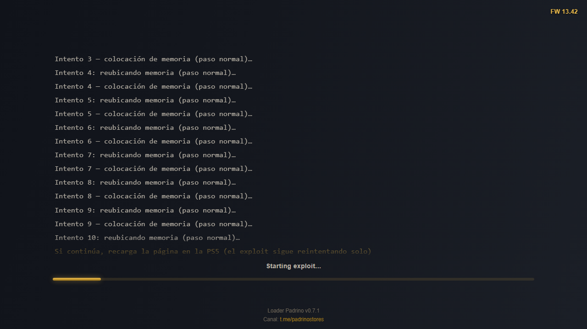
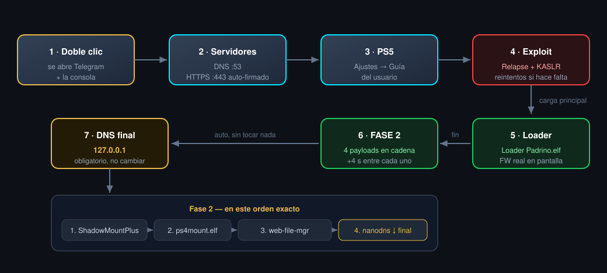

<div align="center">


# 🎮 LOADER JB PADRINO

### *El loader con Fase 2 automática para tu PS5*

<br>


<br>

[](https://github.com/B4ckd0orl/LOADER-JB-PADRINO/releases/latest)
[](https://t.me/padrinostores)

<br>

**Un solo archivo. Sin instalación. Sin dependencias. Con icono propio.**

</div>

---

## 📸 Así se ve

<div align="center">



*Interfaz limpia: sin `[+]`, sin cajas, sin símbolos raros. Solo colores que hablan.*

</div>

> 🖥️ La ventana de consola también es tuya: título **`LOADER JB PADRINO`**,
> icono **Padrino Store** y un banner legible con todo lo que necesitas
> (IP, DNS y el aviso final) de un vistazo.

---

## ✨ Por qué es mejor

<table>
<tr>
<td width="50%">

### 🎨 Interfaz rediseñada
Se acabaron los `[+]`, `[*]` y las cajas de dibujo. **Texto limpio,
colores semánticos** y un separador fino para el bloque Lua.

</td>
<td width="50%">

### 🖼️ Icono propio
El medallón **Padrino Store** en el exe, en el acceso directo y en
la barra de tareas. Nada de icono genérico de Python.

</td>
</tr>
<tr>
<td width="50%">

### 🚀 Más rápido
HTTP/1.1 **keep-alive** + **caché en RAM**: cada ELF se descifra una
vez, no en cada petición. Menos idas y vueltas, cargas más rápidas.

</td>
<td width="50%">

### 🛡️ Estabilidad real
El logging va en su **hilo propio**: si la consola de salida se bloquea,
el servidor **no se cuelga**. Timeout de 30 s y una sola instancia
a la vez (doble clic de más ya no rompe nada).

</td>
</tr>
<tr>
<td width="50%">

### 📲 Telegram al abrir
Doble clic y se abre **[t.me/padrinostores](https://t.me/padrinostores)**
solo. En tests o pipelines jamás se mete (`--no-open` para apagarlo).

</td>
<td width="50%">

### 🔒 Anti-consola-muda
Si el ELF principal no se puede descargar, **se aborta ANTES del
exploit**. Nunca más una PS5 cargada a medias sin ningún mensaje.

</td>
</tr>
<tr>
<td width="50%">

### 🕵️ FW real, siempre
Detecta y muestra la **firmware real** de tu consola en pantalla.
Nada de versiones inventadas ni etiquetas falsas.

</td>
<td width="50%">

### 🇪🇸 Español y claro
Reintentos, avisos y errores en textos que se entienden,
sin cadenas técnicas crípticas.

</td>
</tr>
</table>

---

## 🧬 Cómo funciona

<div align="center">



</div>

---

## 🕹️ Guía de uso (5 pasos)

### 1️⃣ Abre el loader en tu PC
Doble clic en **`LOADER JB PADRINO.exe`** (se abre el canal de Telegram
y la ventana de consola con el título correcto):

```
  LOADER JB PADRINO  v1.0
  PS5 User's Guide host · t.me/padrinostores
  ─────────────────────────────────────────────

  Servidores
    DNS     UDP 53    manuals.playstation.net -> 192.168.1.X
    HTTPS   TCP 443   certificado auto-firmado

  IP PARA EL PS5
    192.168.1.X

  PASOS DE EJECUCION

    1.  Ajustes -> Red -> Configuración -> Personalizado
        DNS primaria:    192.168.1.X
        DNS secundaria:  8.8.8.8   (opcional)

    2.  Ajustes -> Guía del usuario
        (el loader arranca solo y empieza a cargar)

    3.  Al terminar: Ajustes -> Red -> DNS primaria: 127.0.0.1
        OBLIGATORIO - no lo cambies mas

    4.  Reinicia la consola y disfruta de tu jailbreak

Esperando el PS5...

  Cuando termine la carga en la consola:
    Ajustes -> Red -> DNS primaria: 127.0.0.1
    Reinicia la consola y disfruta de tu jailbreak
```

> ⚠️ **El puerto 443 debe estar libre.** Si algo lo usa, el loader te lo
> dirá y **se quedará esperando a que pulses `ENTER`** para que puedas
> leer el error.

### 2️⃣ Apunta tu PS5 al PC
En la consola: **Configuración → Red → Configurar conexión a Internet →
Usar Wi-Fi → Personalizada → DNS → Manual**

| Campo | Valor |
|---|---|
| DNS primaria | `IP de tu PC` *(la que muestre el loader)* |
| DNS secundaria | `8.8.8.8` *(opcional)* |

### 3️⃣ Abre la Guía del usuario
En la PS5: **Configuración → Guía del usuario**.
La consola se conectará a tu PC y el loader arrancará solo.

### 4️⃣ Deja que trabaje
El loader manda el payload principal y, al terminar, ejecuta
la **Fase 2** automáticamente. No toques nada hasta el final.

### 5️⃣ Fija el DNS final y reinicia *(obligatorio)*
Cuando el loader termine, entra a la consola y pon:

### 🔒 **Configuración → Red → DNS primaria → `127.0.0.1`**

> **Déjalo ahí y no lo vuelvas a cambiar.** El DNS local (`nanodns`)
> es parte del jailbreak; si lo vuelves a Automático pierdes el DNS local.
> Después **reinicia la consola** y disfruta de tu jailbreak.

---

## 📦 Payloads incluidos (Fase 2)

Se ejecutan **siempre después** de que el loader principal termina,
uno a uno y en este orden exacto:

| # | Payload | Tamaño | Función |
|---|---|---|---|
| 1 | `ShadowMountPlus_1.7beta11.elf` | 3,6 MB | Montaje de sombra |
| 2 | `ps4mount.elf` | 1,5 MB | Montaje PS4 |
| 3 | `web-file-mgr-v1.14.elf` | 855 KB | Gestor de archivos |
| 4 | `nanodns.elf` | 132 KB | DNS local *(siempre al final)* |

+ **`Loader Padrino.elf`** → el payload principal.

> ⏱️ Entre cada payload hay una **pausa de 4 segundos** (patrón oficial):
> sin esa pausa, las carreras de inicialización crashean la consola.

---

## 🎛️ Opciones avanzadas

<details>
<summary><b>Ver todas las banderas</b></summary>

| Opción | Descripción |
|---|---|
| `--ip IP` | IP que se entrega al dominio suplantado *(por defecto: auto)* |
| `--target DOMINIO` | Dominio a suplantar *(por defecto: `manuals.playstation.net`)* |
| `--dns-port` | Puerto UDP del DNS *(por defecto: `53`)* |
| `--https-port` | Puerto TCP del HTTPS *(por defecto: `443`)* |
| `--http-port` | Sirve también HTTP plano, p. ej. `8080` para probar en el navegador |
| `--strict-host` | Solo responde peticiones con el `Host` exacto del objetivo |
| `--no-dns` | Desactiva el servidor DNS |
| `--no-https` | Desactiva el HTTPS |
| `--verbose` | Registra cada evento DNS, TLS y HTTP |
| `--extract [DIR]` | Extrae el bundle embebido a una carpeta y sale |
| `--no-color` | Desactiva los colores ANSI |
| `--no-open` | No abre el canal de Telegram al arrancar |
| `--open` | Fuerza abrir el canal aunque se pase cualquier argumento |

**Ejemplos**

```powershell
& ".\LOADER JB PADRINO.exe"                      # uso normal
& ".\LOADER JB PADRINO.exe" --http-port 8080     # probar en el navegador
& ".\LOADER JB PADRINO.exe" --verbose            # log completo
& ".\LOADER JB PADRINO.exe" --extract .\out      # sacar el bundle
```

</details>

---

## 🧩 Firmware compatible

Offsets incluidos para **7.00 → 13.60**:

```
7.00  7.01  7.20  7.40  7.60  7.61
8.00  8.20  8.40  8.60
9.00  9.05  9.20  9.40  9.60
10.00 10.01 10.20 10.40 10.60
11.00 11.20 11.40 11.60
12.00 12.02 12.20 12.40 12.60 12.70
13.00 13.20 13.40 13.42 13.60
```

La interfaz muestra **la firmware real** detectada en tu consola en todo momento.

---

## ❓ Preguntas frecuentes

<details>
<summary><b>¿Se cierra solo la ventana en cuanto falla?</b></summary>

No. En una **salida con error fatal** el loader imprime el mensaje y
espera a que pulses `ENTER`. En usos normales o con la salida redirigida
a un archivo, sale directamente sin pausar.
</details>

<details>
<summary><b>¿Tengo que instalar algo?</b></summary>

No. Es un ejecutable único con todo embebido.
</details>

<details>
<summary><b>¿Puedo probarlo en el navegador del PC?</b></summary>

Sí: añade `--http-port 8080` y abre `http://127.0.0.1:8080`.
</details>

<details>
<summary><b>¿Y si el puerto 443 está ocupado?</b></summary>

Verás el error en pantalla sin que la ventana desaparezca. Cierra el
programa que lo use (u otro loader abierto) y vuelve a intentarlo.
</details>

<details>
<summary><b>¿Y si abro el exe dos veces sin querer?</b></summary>

El segundo aviso te lo dice y sale solo: **solo puede haber una instancia
a la vez**, así nunca quedan dos servidores peleando por los puertos.
</details>

---

## ⚠️ Aviso

- Uso bajo tu propia responsabilidad, **solo en consolas que te pertenezcan**.
- **No actualices la consola** mientras uses este loader.
- **Nunca inicies sesión en PSN** en una consola con jailbreak.
- Se entrega **tal cual**, sin garantías.

---

## 📜 Licencia

Distribuido bajo **GNU GPL v3.0** — consulta el archivo [`LICENSE`](./LICENSE).

---

<div align="center">


### 📲 **[t.me/padrinostores](https://t.me/padrinostores)**

**LOADER JB PADRINO** · v1.0

*Hecho para que solo tengas que hacer doble clic.*

</div>
